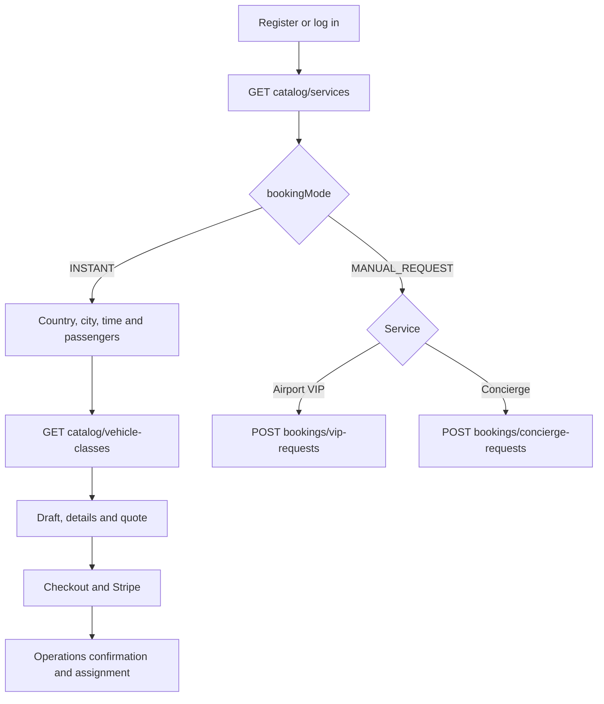
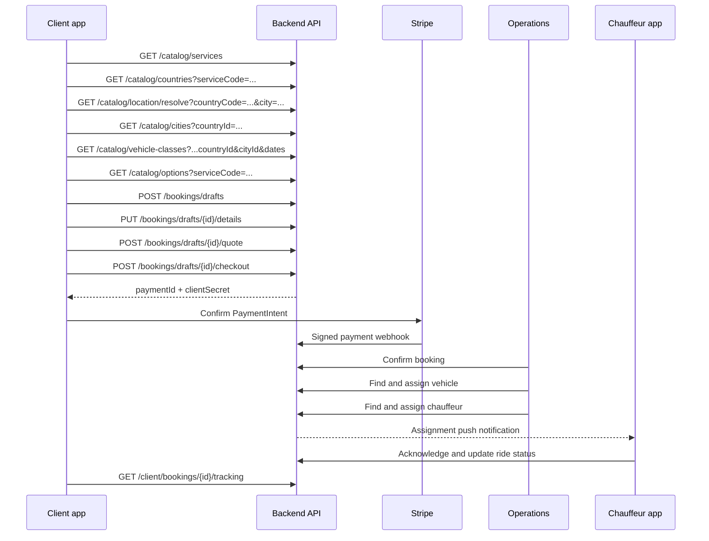
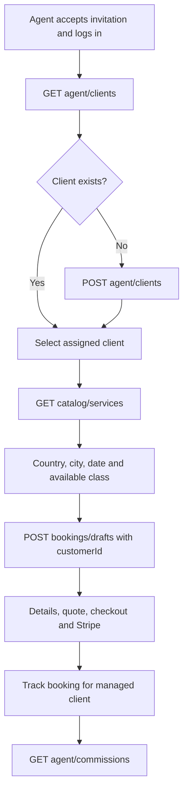

# Frontend API integration flow

All paths below use the `/api/v1` prefix. Protected requests send
`Authorization: Bearer <accessToken>`.

## Service routing



`CHAUFFEUR`, `TRANSFER`, and `CAR_RENTAL` are instant-booking services.
`AIRPORT_VIP` and `CONCIERGE` are manual requests and do not use the vehicle-class
or checkout sequence in Release 1.

## Client instant-booking sequence



The client selects a vehicle **class**. Only Operations can see and allocate a
physical vehicle.

The location resolved from the device is only a default. The user may change
it. Availability uses the final selected `countryId` and optional `cityId` and
only considers active (`status=1`), online-bookable vehicles mapped through the
existing `vehicle_cities` table.

## Agency Agent sequence



The Agent uses the same booking APIs as the Client, but supplies the selected
managed client's `customerId` when creating the draft. The backend verifies the
assignment boundary.

## Chauffeur sequence

```mermaid
flowchart TD
    A[Operations invitation] --> B[POST auth/invitations/accept]
    B --> C[POST auth/login with Expo token]
    C --> D[GET chauffeur/dashboard]
    D --> E[GET chauffeur/assignments/{id}]
    E --> F{Accept?}
    F -->|No| G[POST decline]
    F -->|Yes| H[POST acknowledge]
    H --> I[PREPARING → ON_THE_WAY → ARRIVED]
    I --> J[WAITING → PASSENGER_ONBOARD → IN_SERVICE]
    J --> K[AT_STOP / DROPOFF_REACHED → COMPLETED]
    H --> L[POST location while active]
    I --> M[Optional expense or incident]
```

## Operational discovery APIs

- `GET /operations/vehicles/available` finds physical vehicles without blocks,
  reserved dates, or overlapping allocations.
- `GET /operations/chauffeurs/available` finds active chauffeurs without
  overlapping assignments.
- The corresponding assignment endpoints recheck conflicts transactionally.

## Shared APIs

- `/notifications` provides the in-app inbox; Expo tokens are registered at login.
- `/communication/...` provides booking chat and the masked-call adapter.
- `/documents` uploads private files used by messages, expenses, and incidents.
- `/bookings/{id}/change-requests` and `/cancellation-requests` submit requests
  for Operations approval.
